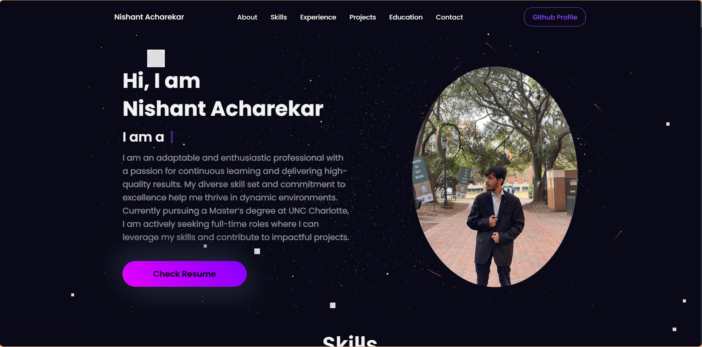

# My Portfolio

A personal portfolio built with React and Vite. It showcases my experience, skills, education, software projects, and creative work (thumbnails, overlays, and video edits), with a Spider-Man-inspired theme, light and dark modes, and background music.

**Live site:** https://nishantacharekarportfolio.netlify.app/

## Features

- Animated loading screen and hero section with rotating role titles
- Light and dark themes, saved in the browser
- Background music with a mute toggle
- Skills grouped by area, with tech icons
- Experience and education with company and school logos
- Project and creative galleries with category filters
- Click an image to enlarge it, click a project card to open it
- Video cards: play YouTube videos inline, or open them on YouTube
- Contact form powered by EmailJS, with a mailto fallback

## Tech Stack

- React 18 and Vite
- Plain CSS with theme variables
- react-icons
- EmailJS for the contact form
- Deployed on Netlify

## Project Structure

```
public/
  images/        project and creative images
  logos/         company and school logos
  music/         background track
  bg/            optional background images
src/
  components/    Navbar, Loader, WorkCard, Contact, Footer, TechChip, Logo
  data/          portfolio.js (all content: profile, skills, experience, projects, creative)
  App.jsx
  index.css
```

Most content changes only need `src/data/portfolio.js`.

## Running Locally

```bash
npm install
npm run dev
```

Open http://localhost:5173 in your browser.

## Building for Production

```bash
npm run build
npm run preview
```

`npm run build` creates a `dist` folder. `npm run preview` serves that build so you can test it before deploying.

## Deployment

The site deploys to Netlify from the `main` branch:

- **Build command:** `npm run build`
- **Publish directory:** `dist`

## Notes

- Image and logo paths start with `/` and point to files in `public/`. File names are case-sensitive on Netlify, so match them exactly.
- The contact form uses EmailJS public keys, which are safe to include in frontend code. Restrict allowed domains in the EmailJS dashboard.

---

Below is the default Create React App documentation, kept as a reference template.

# Getting Started with Create React App

This project was bootstrapped with [Create React App](https://github.com/facebook/create-react-app).

## Available Scripts

In the project directory, you can run:

### `npm start`

Runs the app in the development mode.\
Open [http://localhost:3000](http://localhost:3000) to view it in your browser.

The page will reload when you make changes.\
You may also see any lint errors in the console.

### `npm test`

Launches the test runner in the interactive watch mode.\
See the section about [running tests](https://facebook.github.io/create-react-app/docs/running-tests) for more information.

### `npm run build`

Builds the app for production to the `build` folder.\
It correctly bundles React in production mode and optimizes the build for the best performance.

The build is minified and the filenames include the hashes.\
Your app is ready to be deployed!

See the section about [deployment](https://facebook.github.io/create-react-app/docs/deployment) for more information.

### `npm run eject`

**Note: this is a one-way operation. Once you `eject`, you can't go back!**

If you aren't satisfied with the build tool and configuration choices, you can `eject` at any time. This command will remove the single build dependency from your project.

Instead, it will copy all the configuration files and the transitive dependencies (webpack, Babel, ESLint, etc) right into your project so you have full control over them. All of the commands except `eject` will still work, but they will point to the copied scripts so you can tweak them. At this point you're on your own.

You don't have to ever use `eject`. The curated feature set is suitable for small and middle deployments, and you shouldn't feel obligated to use this feature. However we understand that this tool wouldn't be useful if you couldn't customize it when you are ready for it.

## Learn More

You can learn more in the [Create React App documentation](https://facebook.github.io/create-react-app/docs/getting-started).

To learn React, check out the [React documentation](https://reactjs.org/).

### Code Splitting

This section has moved here: [https://facebook.github.io/create-react-app/docs/code-splitting](https://facebook.github.io/create-react-app/docs/code-splitting)

### Analyzing the Bundle Size

This section has moved here: [https://facebook.github.io/create-react-app/docs/analyzing-the-bundle-size](https://facebook.github.io/create-react-app/docs/analyzing-the-bundle-size)

### Making a Progressive Web App

This section has moved here: [https://facebook.github.io/create-react-app/docs/making-a-progressive-web-app](https://facebook.github.io/create-react-app/docs/making-a-progressive-web-app)

### Advanced Configuration

This section has moved here: [https://facebook.github.io/create-react-app/docs/advanced-configuration](https://facebook.github.io/create-react-app/docs/advanced-configuration)

### Deployment

This section has moved here: [https://facebook.github.io/create-react-app/docs/deployment](https://facebook.github.io/create-react-app/docs/deployment)

### `npm run build` fails to minify

This section has moved here: [https://facebook.github.io/create-react-app/docs/troubleshooting#npm-run-build-fails-to-minify](https://facebook.github.io/create-react-app/docs/troubleshooting#npm-run-build-fails-to-minify)

## Learn More

You can learn more in the [Create React App documentation](https://facebook.github.io/create-react-app/docs/getting-started).

To learn React, check out the [React documentation](https://reactjs.org/).

### Code Splitting

This section has moved here: [https://facebook.github.io/create-react-app/docs/code-splitting](https://facebook.github.io/create-react-app/docs/code-splitting)

### Analyzing the Bundle Size

This section has moved here: [https://facebook.github.io/create-react-app/docs/analyzing-the-bundle-size](https://facebook.github.io/create-react-app/docs/analyzing-the-bundle-size)

### Making a Progressive Web App

This section has moved here: [https://facebook.github.io/create-react-app/docs/making-a-progressive-web-app](https://facebook.github.io/create-react-app/docs/making-a-progressive-web-app)

### Advanced Configuration

This section has moved here: [https://facebook.github.io/create-react-app/docs/advanced-configuration](https://facebook.github.io/create-react-app/docs/advanced-configuration)

### Deployment

This section has moved here: [https://facebook.github.io/create-react-app/docs/deployment](https://facebook.github.io/create-react-app/docs/deployment)

### `npm run build` fails to minify

This section has moved here: [https://facebook.github.io/create-react-app/docs/troubleshooting#npm-run-build-fails-to-minify](https://facebook.github.io/create-react-app/docs/troubleshooting#npm-run-build-fails-to-minify)


